# Safe actions: no risky action on one click

**Design of record:** [clickable prototype](prototype/index.html) · [every screen on one canvas](canvas/index.html) · **Status:** Ready for review

Copy, breakdown rows and states for every surface: [spec](https://github.com/product-team-sh/prd-safe-actions/blob/main/safe-actions-spec.md).

## 1. Problem

Bulk actions act on up to 25,000 records per click. On 6 bulk bars the destructive action is an unlabelled icon that fires at once, with no confirmation and no undo; where a confirmation exists it rarely says how many or what breaks. The selection banner hides when the selection is everything. A customer emptied a 7-prospect sequence this way and lost its progress, events and drafts for good (measured, 7 Oct 2026).

## 2. Why this approach

| Picked | Rejected |
|---|---|
| Show the real selection scope; label risky actions and set them apart | Confirm in place on the button: a double-click goes straight through |
| One dialog on every risky action, saying what happens | Skipping the dialog for small or undoable actions: that is how the 7-prospect sequence was emptied |
| 10-second undo | 30-day restore: large backend change, prevalence not measured |
| Identity re-check, credit totals, plan-change picker | Second-admin approval: too slow |

About 110 risky actions audited: about 35 unconfirmed, about 35 with a confirmation that hides the count or consequence (measured, webui `aeda4e3`; [audit](https://github.com/product-team-sh/prd-safe-actions/blob/main/confirmation-audit.md)). How often users lose data this way is not measured.

## 3. What we're building

1. Every bulk table says how much is selected relative to everything; risky actions are labelled and set apart.
2. Every risky action, from one item to 25,000, opens a dialog that says what happens and what is lost. On Sequence > Prospects the dialog is short: the action's icon and name, the consequence, who is skipped, and "This can't be undone" only when that is true.
3. Changes that lose nothing outside Saleshandy can be undone for 10 seconds. Security switches need the password, spends show the total, plan cuts let the user pick what goes.

**Invariant:** nothing that deletes, removes, stops sending, spends or weakens security fires on a single click.

## 4. User stories

| ID | Story |
|---|---|
| US1 | Before acting, I see my selection is "All 7 prospects in this sequence", so I never empty a sequence by accident. |
| US2 | Before removing, deleting or unsubscribing, I see how many and which ones matter (replied, about to send), so I can stop. |
| US3 | If I clicked the wrong thing, I can undo within 10 seconds and get everything back as it was. |
| US4 | As an admin, I re-enter my password before switching off email codes or SSO for everyone. |
| US5 | Before spending credits, I see the total, my balance and what is left. |
| US6 | When reducing slots or downgrading, I pick which mailboxes or users go and see what stops on the date. |

## 5. Decisions

**D1 – The impact dialog appears on every risky action, including a single item.** It never lists the names of the selected items, since the selection stays visible behind it, and never counts what is due in a time window (next hour, today, next 24 hours). **Consequence to accept:** one extra step on frequent clean-up work.

**D2 – Typing to confirm stays only where production asks for it today** (typed "delete" on sequence, subsequence, step and variant delete). The Sequence > Prospects dialogs never ask to type. Whether other new red dialogs ask to type is Q5. **Consequence to accept:** on Sequence > Prospects, one click on the red button inside the dialog removes or unsubscribes.

**D3 – Undo lasts 10 seconds; there is no restore after that.** No undo on spends, security switches, plan changes, account deletion, or disconnecting integrations and mailboxes (their side effects outside Saleshandy happen at once). No undo on Remove from sequence: their progress in the sequence is deleted. No undo on Unsubscribe: a prospect is shared across sequences, so the system can't tell a user's resubscribe from the recipient's own unsubscribe, a compliance risk. No undo on Mark as finished: undoing would send the remaining steps. All three dialogs say so and give the way back: add them to the sequence again (engineering review, 19 Nov 2026). **Consequence to accept:** a mistake noticed later stays unrecoverable; on Sequence > Prospects the dialog is the only guard for Remove, Unsubscribe and Mark as finished.

## 6. Surfaces

Every state below opens from the prototype's demo bar, with a Today / Proposed switch on each screen. To compare every screen side by side, open the [canvas](canvas/index.html).

### 6.1 Sequence > Prospects (rows 1-4)

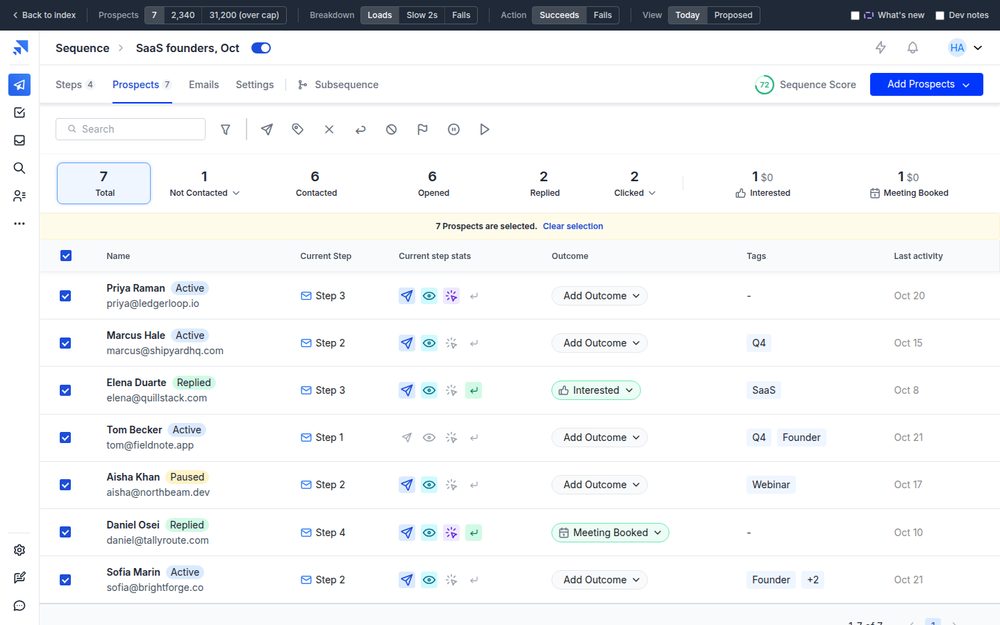

**Why.** The remove action is an X among seven similar icons and fires at once; the banner hides that the selection is the whole sequence.

**Bar, icons only with a tooltip each, left to right:** Tags | Add to sequence, Pause, Resume | Mark as replied, Mark as finished | Unsubscribe, Remove (both red). The Change status menu is dropped. With nothing selected the icons are disabled with "Select prospects first".

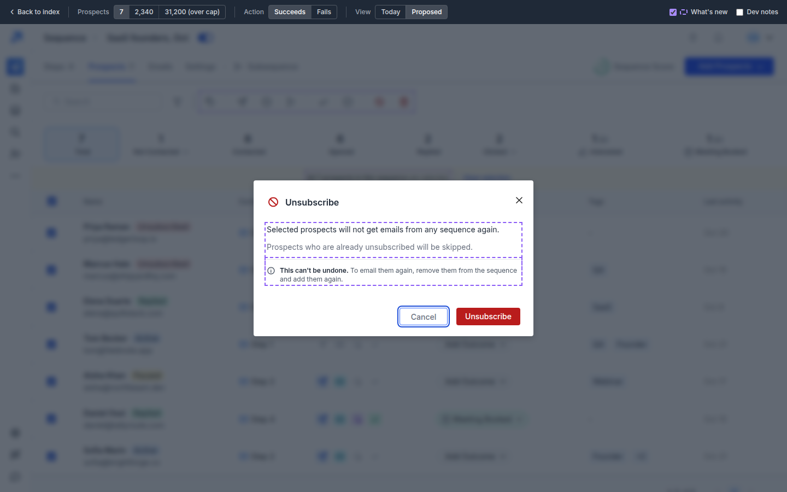

**Dialogs.** Title = the action's name with its bar icon; no count, no breakdown, no routine undo line, no typing. Copy per action is in the [spec](https://github.com/product-team-sh/prd-safe-actions/blob/main/safe-actions-spec.md#sequence--prospects-dialogs).

| ID | Case | Expected | P |
|---|---|---|---|
| SP-1 | 7 prospects, header checkbox ticked | Banner reads "All 7 prospects in this sequence are selected." | P0 |
| SP-2 | Remove with all selected | Title "Remove from sequence"; body ends "This leaves the sequence empty."; note "This can't be undone. To email them again, add them to the sequence again."; Cancel / Remove (red); no typed field | P0 |
| SP-3 | Remove, Unsubscribe or Mark as finished, confirm | Dialog said "This can't be undone." and the way back; toast has no Undo | P0 |
| SP-4 | Cancel, Esc or the X on any of these dialogs | Nothing changes; selection kept | P0 |
| SP-5 | Selection includes prospects already in the target state (e.g. already unsubscribed) | Dialog adds "Prospects who are already unsubscribed will be skipped."; line absent when nobody is skipped | P1 |
| SP-6 | Mark as replied, Pause, Resume | Dialog states the consequence; Pause keeps today's duration picker; replied gets the 10 s undo | P1 |

### 6.2 Sequence list (rows 5, 37)

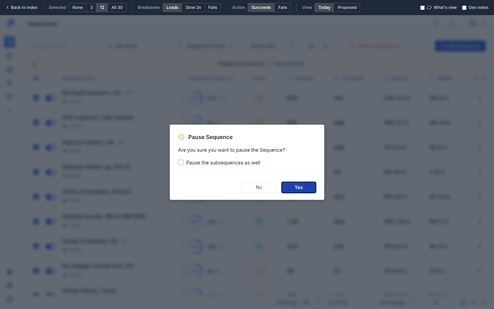

**Why.** Bulk pause does not say how many prospects stop; delete says nothing about what is lost.

| ID | Case | Expected | P |
|---|---|---|---|
| SL-1 | Pause 12 | Rows: prospects who stop getting emails, subsequences; no list of sequence names (the selection stays visible behind the dialog); undo 10 s | P0 |
| SL-2 | Delete 3 | Rows: prospects in progress, subsequences deleted with them; no names list; "This can't be undone."; primary disabled until "delete" is typed; no undo | P0 |
| SL-3 | Resume includes a sequence with a disconnected mailbox | That sequence is left out and named in a note | P1 |

### 6.3 Sequence > Steps and Settings (rows 6, 7)

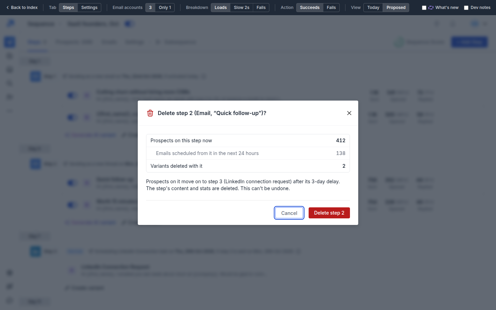

**Why.** Deleting a step or removing a sender moves or stops live prospects, and neither dialog says so.

| ID | Case | Expected | P |
|---|---|---|---|
| ST-1 | Delete step 2 with 412 prospects on it | Consequence says they move to step 3 after its delay; "delete" typed to enable | P0 |
| ST-2 | Remove the only email account | Consequence says the sequence pauses | P0 |

### 6.4 Unified Inbox (rows 8-10)

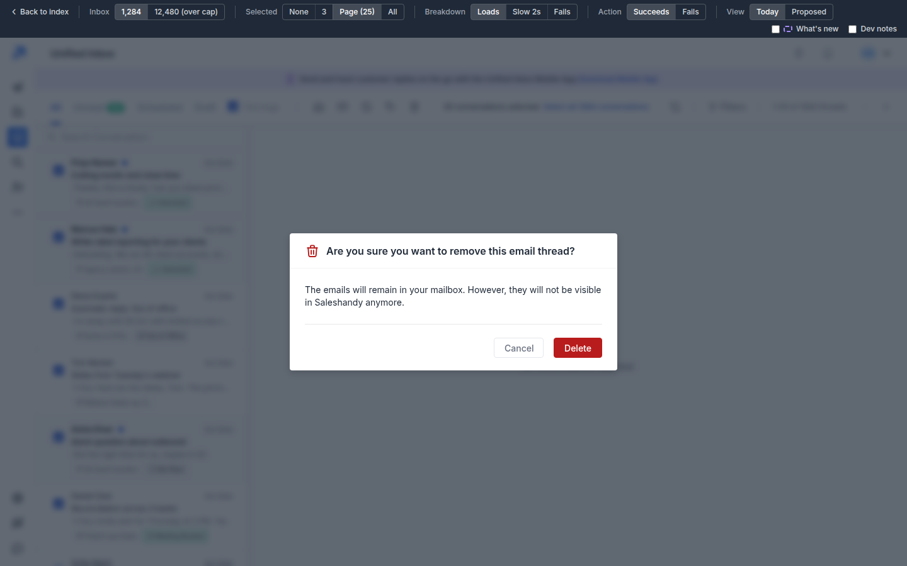

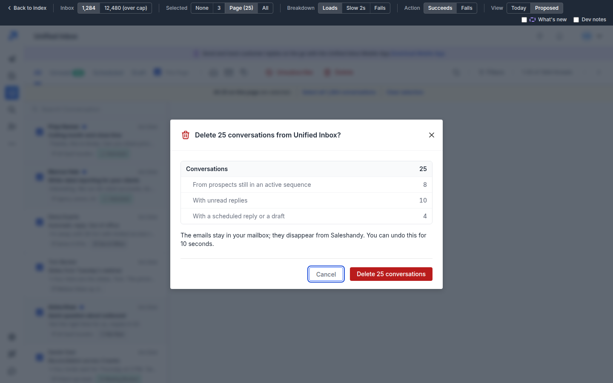

**Why.** Bulk actions reach 10,000 threads; the copy is written for one.

| ID | Case | Expected | P |
|---|---|---|---|
| IN-1 | Delete 25 | Says the emails stay in the mailbox; undo 10 s | P0 |
| IN-2 | Unsubscribe 25 | Counts unique prospects, not threads | P0 |
| IN-3 | Assign "Interested" to 25 | Shows how many existing outcomes are replaced; undo restores each thread's earlier outcome | P1 |

### 6.5 Tasks (row 11)

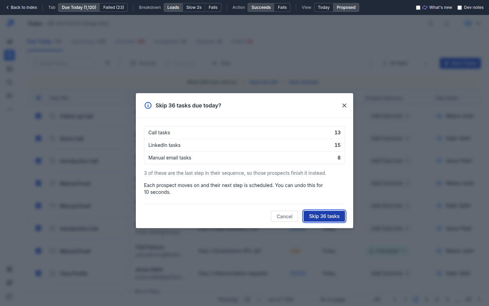

**Why.** Bulk skip moves up to 25,000 prospects on, with no count and no undo.

| ID | Case | Expected | P |
|---|---|---|---|
| TK-1 | Skip 36 | Rows by task type and prospects who move on; undo 10 s | P0 |
| TK-2 | Hover Skip on one row | No dialog; undo lasts 10 s (today 5 s) | P1 |

### 6.6 CRM prospects and AI columns (rows 12-14, 16)

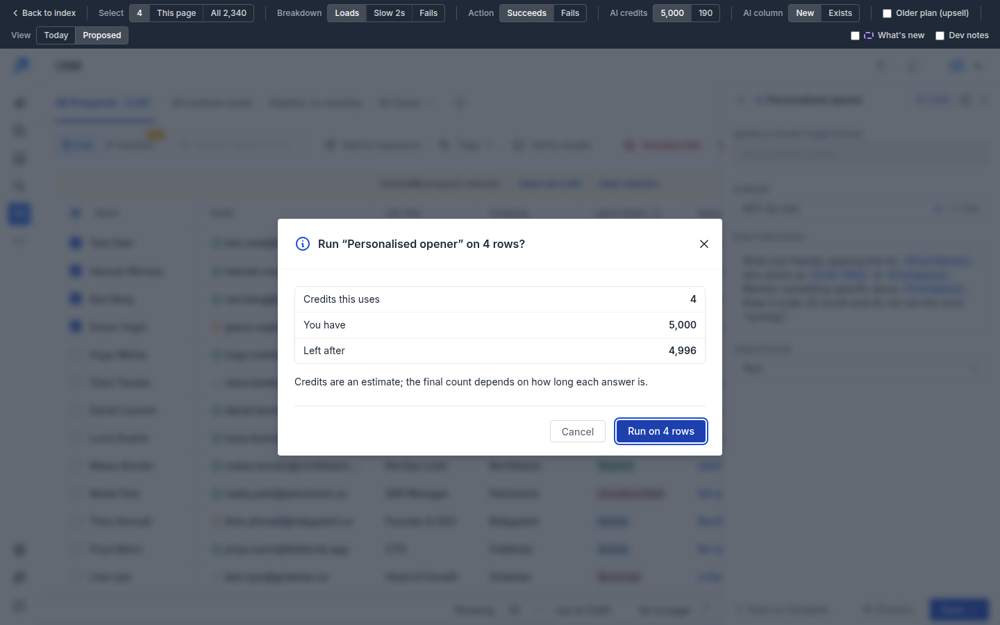

**Why.** Delete is permanent at up to 25,000; the AI column spends credits with no total.

| ID | Case | Expected | P |
|---|---|---|---|
| CR-1 | Delete 4 | Rows: in active sequences, with replies, with notes; undo 10 s | P0 |
| CR-2 | Remove 2 tags when only 2 of 4 selected have them | Title and button count 2 | P1 |
| CR-3 | AI run with 190 credits for 480 rows | Shortfall shown; "Buy credits"; partial "Run on 190 rows" | P1 |

### 6.7 Import CSV (row 15)

**Why.** Update All Fields and Overwrite both let a blank cell erase an existing value (measured, edge `4617c54`); today only a tooltip warns.

| ID | Case | Expected | P |
|---|---|---|---|
| CS-1 | Import with Update All Fields or Overwrite | Dialog first: prospects that change, values cleared by blank cells, new prospects | P0 |
| CS-2 | Import with Add Missing Fields or Skip | No dialog | P0 |

### 6.8 Email accounts (rows 17-20)

**Why.** Deleting or pausing a mailbox stops every sequence that sends from it; the pause switch has no confirmation.

| ID | Case | Expected | P |
|---|---|---|---|
| EA-1 | Delete 6 | Rows: active sequences that pause, sequences that keep sending; no list of account names; no undo | P0 |
| EA-2 | Pause switch | Dialog names the account; undo 10 s | P1 |

### 6.9 Lead Finder and Email Verifier (rows 21-25)

**Why.** Credits are spent without a total; the Email Verifier spends and clears the input on click.

| ID | Case | Expected | P |
|---|---|---|---|
| LF-1 | Reveal emails and phones for 250 | One row per type with its credits, total last; under it one line with the balance and what is left after | P0 |
| LF-2 | Verify fails | Input kept; cleared only on success | P1 |

### 6.10 Settings (rows 26-32)

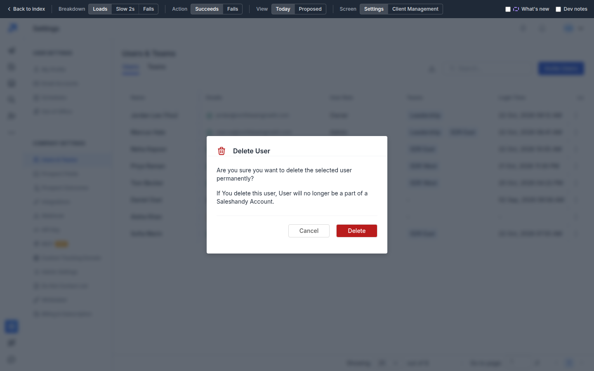

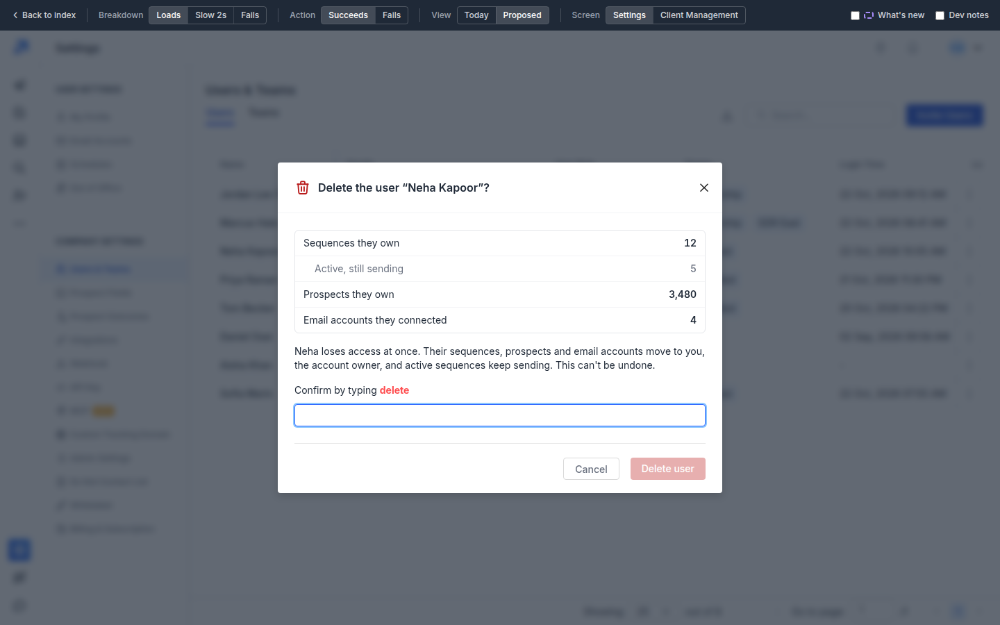

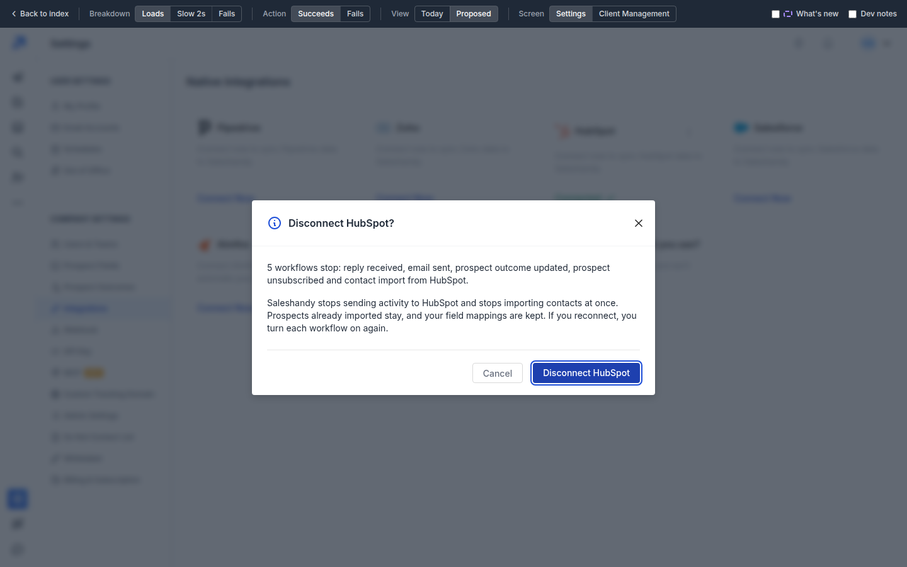

**Why.** These name neither the item nor what depends on it; CRM disconnect and client password reset fire on one click.

| ID | Case | Expected | P |
|---|---|---|---|
| SE-1 | Delete user | Rows: sequences, prospects, email accounts they own; says where they go | P0 |
| SE-2 | Delete a schedule in use | Blocked inside the dialog with the sequences named | P1 |
| SE-3 | Disconnect HubSpot | Names the workflows that stop; says field mappings are kept | P1 |

### 6.11 Admin settings, profile and billing (rows 33-36)

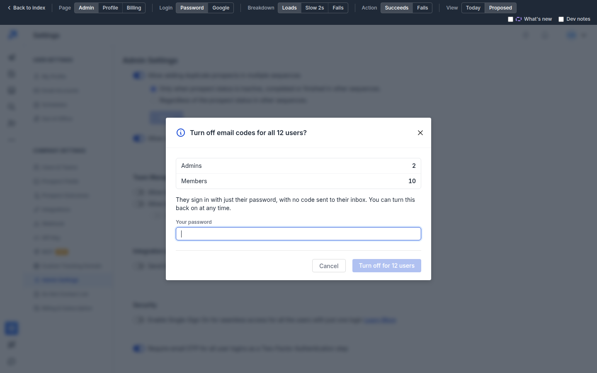

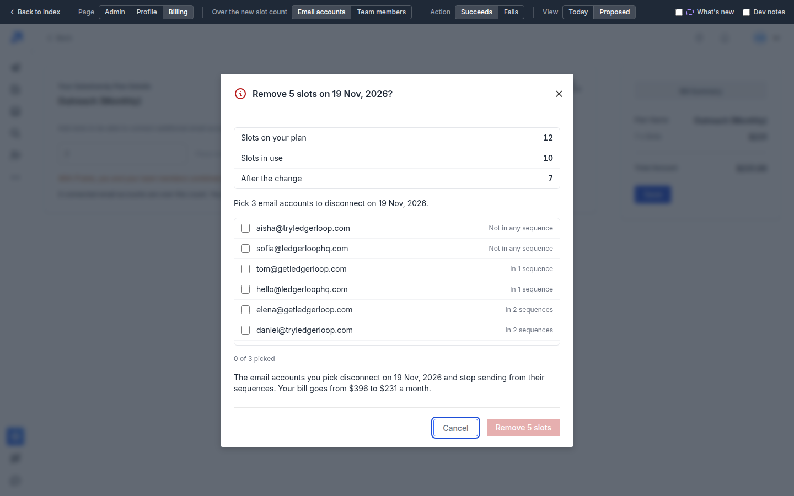

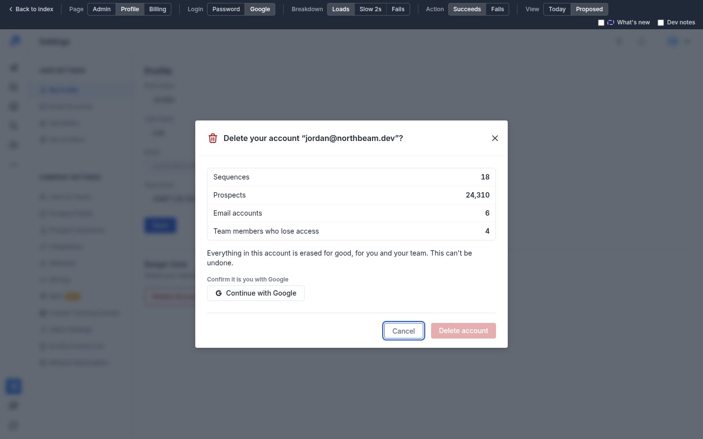

**Why.** Security switches flip on one click; reducing slots is a dead end; Google users delete their account with no warning.

| ID | Case | Expected | P |
|---|---|---|---|
| AB-1 | Switch off email codes | Disabled until the password is entered or Google confirms | P0 |
| AB-2 | Reduce 12 slots to 7 with 10 in use | Exactly 3 mailboxes must be picked; bill before and after; dated at renewal | P0 |
| AB-3 | Delete account, Google user | Lists what is erased; disabled until Google confirms and "delete" is typed | P0 |

## 7. Reconciliation with existing behaviour

| Existing | Becomes |
|---|---|
| Single "Remove from sequence" alert (AL-2724) | The impact dialog, same as bulk |
| CRM delete modal and "Wait! No need to delete" upsell | Impact dialog; the upsell stays as one line inside it |
| Typed "delete" on sequence, subsequence, step and variant delete | Kept, inside the impact dialog |
| Seven unlabelled icons on the Sequence > Prospects bar, X for remove | Same actions regrouped; trash for remove; Unsubscribe and Remove red at the end |
| Tasks single Skip / Complete undo (5 s) | 10 s |
| "Action Stats" modal after bulk pause / resume | Dropped; failures become a toast with a count and reason |
| Slot input floored at what is in use | Replaced by the picker |

## 8. Cross-cutting (release blockers)

| Rule | Behaviour |
|---|---|
| Counting | Dialogs with a breakdown open at once with title and count; placeholder rows; primary enabled |
| Breakdown fails | "We couldn't load the details. You can still continue." Action allowed |
| Submitting | Spinner; further clicks ignored |
| Action fails | Dialog stays open with what happened and what to do |
| Typed verb | Where D2 keeps it; verb = first word of the red button; enabled only when it matches (trim, any case) and every other condition holds; Enter submits |
| Colour | Red when data is lost (delete, remove with history, unsubscribe); blue otherwise |
| Keyboard | Esc and outside click cancel; focus on the typed field when there is one, else Cancel on red dialogs and the primary on blue |
| Undo | Rows leave at once; 10 s; pauses on hover; restores position and status; a second action commits the first; leaving the page still commits |

## 9. Implementation notes

| Backend ask | Needed by | Resolve before estimation |
|---|---|---|
| Breakdown counts before the dialog opens | Bulk impact dialogs | Which counts return under 500 ms for 25,000 selected (assumed budget) |
| Delay bulk changes 10 s, cancellable | Undo | Which bulk jobs already run in the background (sequence prospects do; CRM delete and email account delete unknown) |
| Identity re-check | Security switches | Reuse the delete-account password check; how SSO owners re-check |
| Plan-change preview | Slots and downgrade | What happens to a removed member's sequences and mailboxes at renewal |

Each screen's Dev notes in the prototype lists its assumptions; all are resolve before estimation.

## 10. Measurement

**Privacy:** no prospect emails, names or message content in events; counts and surface IDs only.

| Event | Fires when | Properties |
|---|---|---|
| `risky_action_dialog_shown` | Any of these dialogs opens | surface, action, count |
| `risky_action_confirmed` | Action succeeds | surface, action, count, ms_open |
| `risky_action_cancelled` | Cancel, Esc, outside click | surface, action, count |
| `risky_action_undone` | Undo clicked | surface, action, count, seconds_after |

| Indicator | Healthy | Investigate |
|---|---|---|
| **Cancel rate per surface (main early signal)** | 2% to 15% (target) | Under 1% or over 30% |
| Undo rate per surface | Under 5% (target) | Over 10% |
| Tickets about accidental removal or deletion | Down from baseline at 90 days (baseline to capture before stage 1) | Flat |

**Guardrail:** undo rate over 10% on any surface for 7 days halts the next stage.

## 11. Rollout

| Stage | Surfaces | Gate |
|---|---|---|
| 1 | Sequence > Prospects | Events live |
| 2 | CRM prospects, Unified Inbox, Tasks, Sequence list, email accounts | Stage 1 cancel rate healthy for 14 days |
| 3 | Steps, CSV import, Lead Finder, Email Verifier, Settings, Admin, Billing | Stage 2 healthy for 14 days |

No stage ships before undo works for its surfaces.

## 12. Open questions

| # | Question | Recommendation |
|---|---|---|
| Q1 | Does bulk Resume touch subsequences? | Dev to confirm before stage 2 |
| Q2 | Where does a deleted user's data go? | Prototype assumes the owner; confirm before stage 3 |
| Q3 | Does a scheduled reply still send after its thread is deleted? **Blocks Unified Inbox.** | If yes, deleting must cancel it |
| Q4 | Add a 30-day restore later? | Revisit with 90 days of undo and ticket data |
| Q5 | Do the short dialog and no-typing rules apply to the other 10 screens? | Yes, for one consistent pattern; keep production's typed "delete" |

## Appendix

[Prototype](prototype/index.html) · [Spec](https://github.com/product-team-sh/prd-safe-actions/blob/main/safe-actions-spec.md) · [Audit](https://github.com/product-team-sh/prd-safe-actions/blob/main/confirmation-audit.md) · [Directions explored](prototype/01-directions.html) · Source: Basecamp card "Prospects gets deleted with just one click." (7 Oct 2026)
