# Safe actions: no risky action on one click

**Design of record:** [clickable prototype](prototype/index.html) (11 screens, Today vs Proposed on each) · **Status:** Ready for review

Per-surface copy, breakdown rows and dialog states are in the [spec](https://github.com/product-team-sh/prd-safe-actions/blob/main/safe-actions-spec.md). This PRD states what changes, why, and how it is judged; the prototype is the visual record.

## 1. Problem

**What users do.** They tick a header checkbox or "Select all" and click a bulk action to clean a list: remove prospects from a sequence, mark them finished, delete prospects, disconnect mailboxes. Up to 25,000 records per click.

**What actually happens.** On 6 of the bulk bars the destructive action is an unlabelled icon that fires immediately: no confirmation, no count, no undo. On Sequence > Prospects, "Remove from sequence" is an X, which reads as "close". Where a confirmation exists, it rarely says how many or what else breaks ("Are you sure you want to delete the selected prospects."). The product confirms removing **one** prospect from a sequence, but not removing 25,000. A reported case: a customer removed all 7 prospects of a sequence with the header checkbox and one click on the X; their progress, events and drafts in that sequence were deleted and could not be restored (measured, 7 Oct 2026, Metabase timeline and code at webui `aeda4e3`).

**Why they do not find out.** Nothing tells them the selection covered everyone (the banner says "7 Prospects are selected", and hides "Select all" when the page already holds everyone), the button gives no count, and the success toast arrives after the data is gone.

**Problems the fix creates.** More dialogs add a click to frequent clean-up work; this is answered by making every dialog say something specific and by the 10-second undo. Undo needs the backend to delay bulk changes; that is a backend ask (§9).

## 2. Why this approach

13 directions were explored and scored on loss prevented, friction, reach and build cost ([directions](prototype/01-directions.html)). Picked:

| Picked | Rejected, and why |
|---|---|
| **A** selection banner states real scope · **B** risky actions labelled and set apart · **C** one explained "Change status" menu | Confirm in place on the button: a double-click goes straight through |
| **F** impact dialog with a breakdown on every risky action | A tiered rule (no dialog for small or undoable actions) and type-to-confirm for big ones: decided against, one consistent ask everywhere (D1, D2) |
| **H** 10-second undo on changes that lose nothing outside Saleshandy | 30-day restore: a large backend change and we have no data on how often this happens; activity log: does not prevent the loss |
| **K** prove it is you for account-wide security switches · **L** total credits before any spend · **M** plan changes name what stops | Second-admin approval: too slow for daily list cleaning |

**Evidence.** About 110 risky actions audited in production code: about 35 have no confirmation, about 35 have one that hides the count, item or consequence (measured, code read at webui `aeda4e3`; [audit](https://github.com/product-team-sh/prd-safe-actions/blob/main/confirmation-audit.md)). Thread delete in Unified Inbox is already a soft delete, so its undo is cheap (measured, edge `4617c54`).

**Not claimed.** How often users lose data this way. The 90-day query over removal timestamps timed out and support data was not reachable; prevalence is not measured. This PRD fixes a defect class, it does not size it.

## 3. What we're building

1. Before any risky bulk action, the screen says exactly how much is selected relative to everything, and the risky button is a labelled, separated, plain verb.
2. Every risky action, from one item to 25,000, opens one dialog that names the count or item, breaks down what is affected, and says what is lost and whether it can be undone.
3. Changes that lose nothing outside Saleshandy can be undone for 10 seconds; security switches, spends and plan changes are guarded by identity, total cost and a named list of what stops.

**Invariant:** no action that deletes, removes, stops sending, spends or weakens security fires on a single click.

## 4. User stories

| ID | Story |
|---|---|
| US1 | As a user cleaning a sequence, I see that my selection is "All 7 prospects in this sequence" before I act, so I never empty a sequence by accident. |
| US2 | As a user about to remove, delete or unsubscribe, I see how many, which ones matter (replied, scheduled to send, in other sequences) and what I lose, so I can stop if it is wrong. |
| US3 | As a user who clicked the wrong thing, I can undo within 10 seconds and get everything back as it was. |
| US4 | As an admin, I must prove it is me before switching off email codes or SSO for every user, so an unattended tab cannot weaken the account. |
| US5 | As a user spending credits, I see the total, my balance and what is left before anything is spent. |
| US6 | As an owner reducing slots or downgrading, I choose which mailboxes or users go and see what stops on the date, instead of hitting a dead end or finding out at renewal. |

## 5. Decisions

**D1 – One impact dialog (F) on every risky action, including a single item.** Rationale: one consistent ask is learnable; a rule that skips the dialog for "small" actions is how a 7-prospect sequence was emptied. **Consequence to accept explicitly:** one extra click on frequent clean-up work; we rely on undo and specific copy to keep it cheap.

**D2 – No type-to-confirm anywhere.** Replaces today's typed "delete" on Delete step and Delete sequence. Rationale: typing a word trains muscle memory, not reading; the count in the title does the work. **Consequence to accept explicitly:** emptying a whole sequence, deleting 25,000 prospects or deleting a sequence is guarded only by a red dialog whose title says "all" or names the sequences, and whose consequence says what is lost.

**D3 – Undo for 10 seconds only; no restore after that.** Rationale: covers the wrong-click case at modest backend cost. **Consequence to accept explicitly:** a mistake noticed later (the reported customer noticed after 4 minutes) is still unrecoverable. Restore is deferred until we can measure how often it happens.

**D4 – The risky button carries no count.** "Remove", "Delete", "Skip". The count lives in the selection banner and in the dialog title and primary button ("Remove 7 prospects"). **Consequence to accept explicitly:** the count is not visible at the moment of the first click; the banner directly below and the dialog carry it.

**D5 – Red only when data is lost.** Red: deleted, removed with history, never undoable (unsubscribe). Blue: pause, resume, assign outcome, skip, remove tags, remove from a list. **Consequence to accept explicitly:** some "remove" actions are blue, which reviewers will question; the rule is about loss, not the verb.

**D6 – Undo is not offered** for spends, security switches, plan changes, account deletion, or disconnecting integrations and mailboxes (side effects outside Saleshandy happen at once). **Consequence to accept explicitly:** these rely on F, K, L and M alone.

## 6. Surfaces

Each screen below shows today and the proposal. The prototype has a Today / Proposed switch on every screen; every state below opens from the demo bar. Literal copy for every dialog is in the [spec, Surfaces table](https://github.com/product-team-sh/prd-safe-actions/blob/main/safe-actions-spec.md).

### 6.1 Sequence > Prospects (spec rows 1-4) – the reported case

**What it's for.** Cleaning or changing the prospects of one sequence; users arrive from the sequence list or straight from a launch.

**Why it changes.** The X reads as "close", sits among seven similar icons, and fires with no confirmation; the banner hides that the selection is the whole sequence.

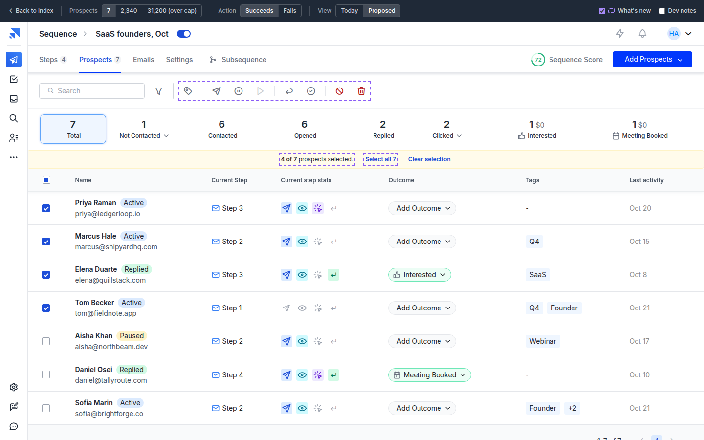

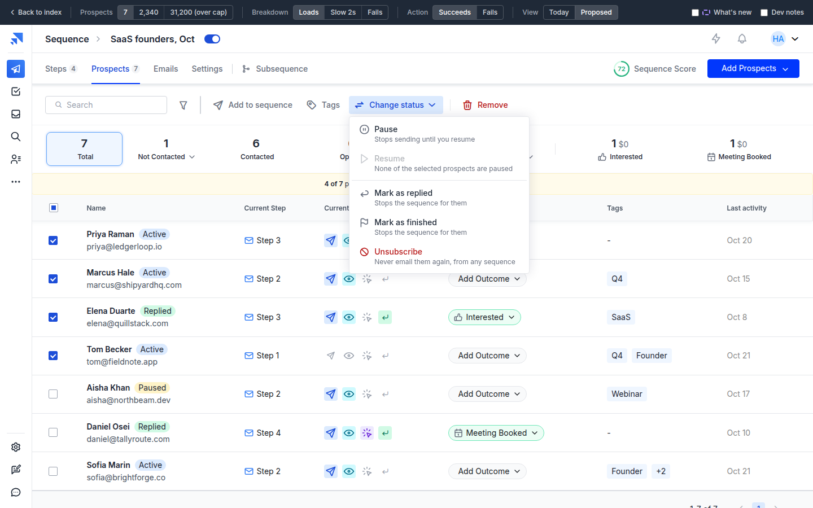

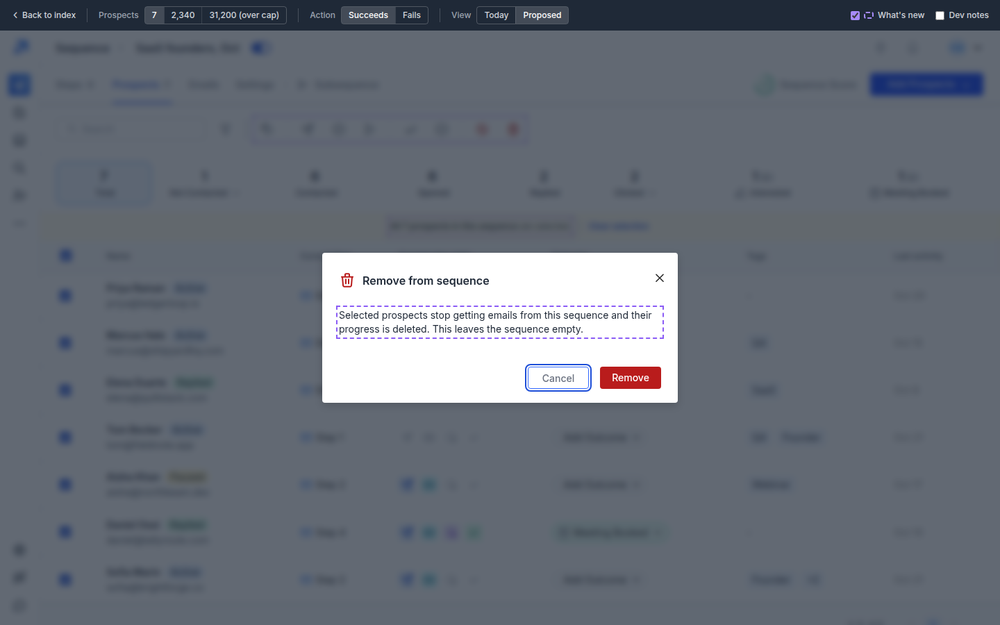

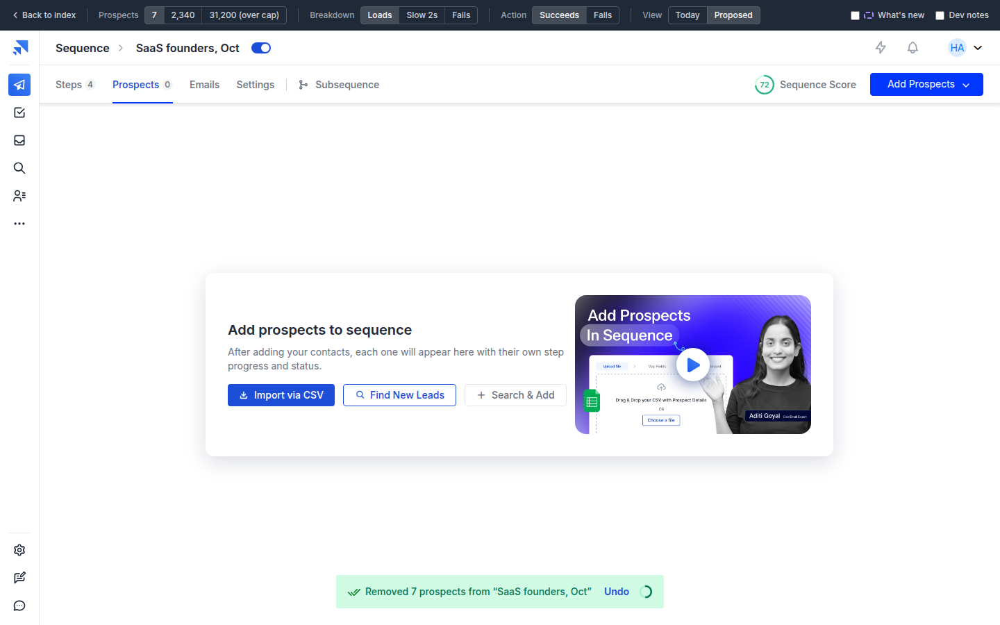

**What it must do**
- Banner states scope per spec A: "7 of 2,340 prospects selected.", "All 25 on this page are selected.", "All 7 prospects in this sequence are selected.", "First 25,000 of 31,200…".
- Bar: Add to sequence, Tags, Change status, divider, red "Remove" (trash icon, never an X). No count on the button.
- Change status replaces the five status icons: Pause, Resume, divider, Mark as replied, Mark as finished, Unsubscribe (red). Options that do not apply are disabled with the reason.
- Every action opens F; then undo (H). Pause keeps today's duration picker inside the dialog.

| ID | Case | Expected | P |
|---|---|---|---|
| SP-1 | 7 prospects, header checkbox ticked | Banner reads "All 7 prospects in this sequence are selected." | P0 |
| SP-2 | Click Remove with all selected | Dialog title "Remove all 7 prospects from “SaaS founders, Oct”?"; consequence includes "This empties the sequence."; nothing removed until the primary is clicked | P0 |
| SP-3 | Confirm, then Undo within 10 s | All 7 rows return with the same step, status and outcome; no email went out in between | P0 |
| SP-4 | Confirm, wait 10 s | Removal commits; Undo no longer offered | P0 |
| SP-5 | Mark as replied on 3 already-replied prospects | Option disabled with its reason | P1 |

**Sign off by name (owner: QA lead, unassigned):** SP-3. It is the only criterion whose failure loses customer data while telling the user it is safe.

### 6.2 Sequence list (rows 5, 37)

**Why it changes.** Bulk pause names neither the sequences nor how many prospects stop; bulk delete needs a typed word but says nothing about what is lost.

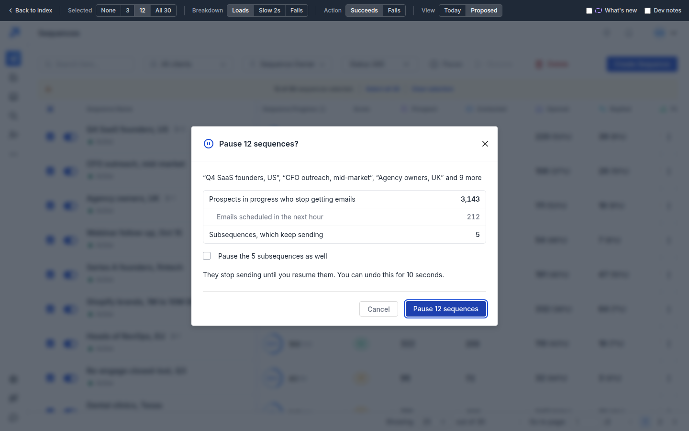

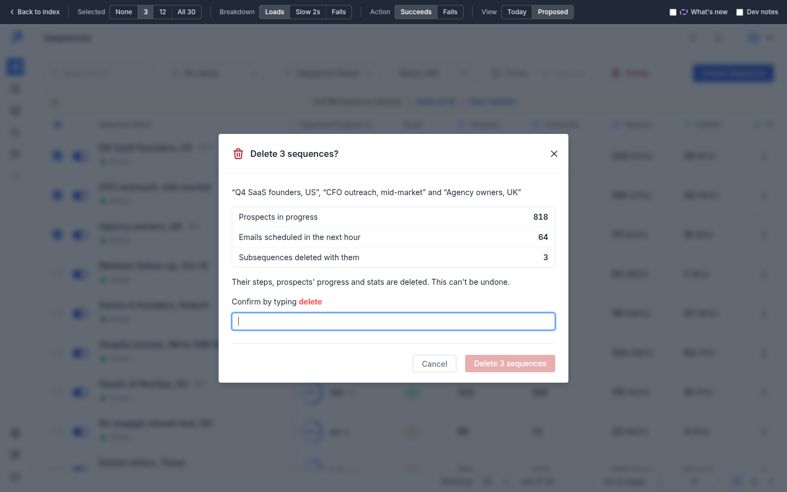

**What it must do.** Banner per A (noun "sequence"). Pause / Resume (blue) and Delete (red) open F, naming the first 3 sequences "and N more". Pause keeps today's "Pause the 5 subsequences as well" checkbox, now with its count. Pause and Resume get undo; Delete does not. A sequence that cannot resume (disconnected mailbox) is left out and named in a note.

| ID | Case | Expected | P |
|---|---|---|---|
| SL-1 | Pause 12 | Title "Pause 12 sequences?"; rows: prospects who stop getting emails, emails in the next hour, subsequences | P0 |
| SL-2 | Delete 3 | Red F dialog "Delete 3 sequences?"; no text field to type; "This can't be undone." | P0 |

### 6.3 Sequence > Steps and Settings (rows 6, 7)

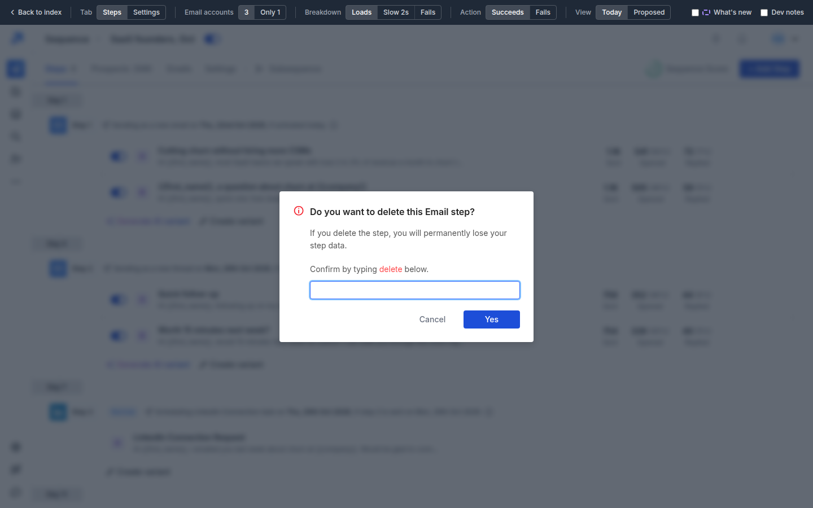

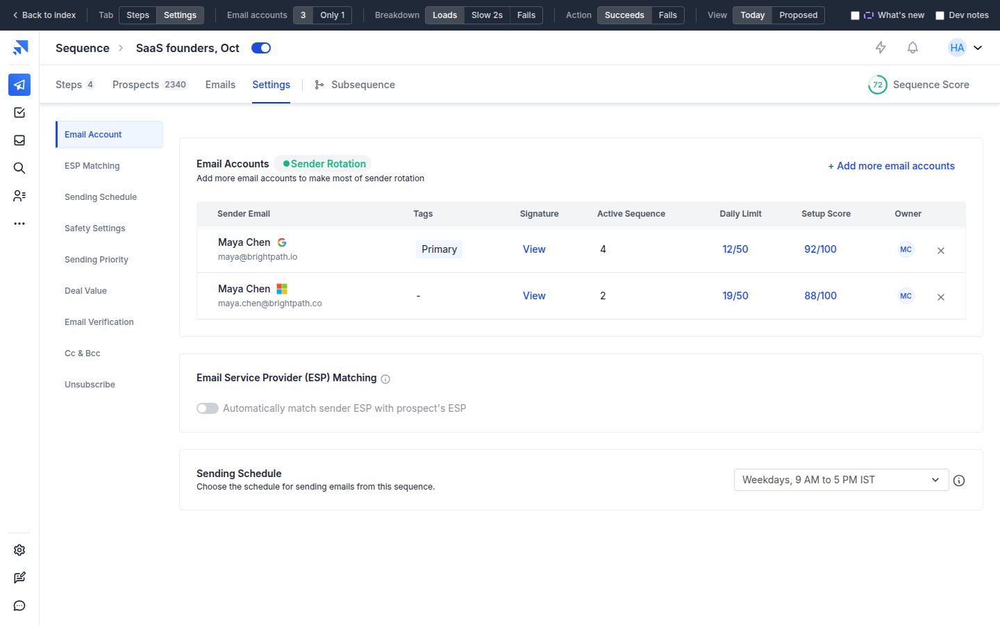

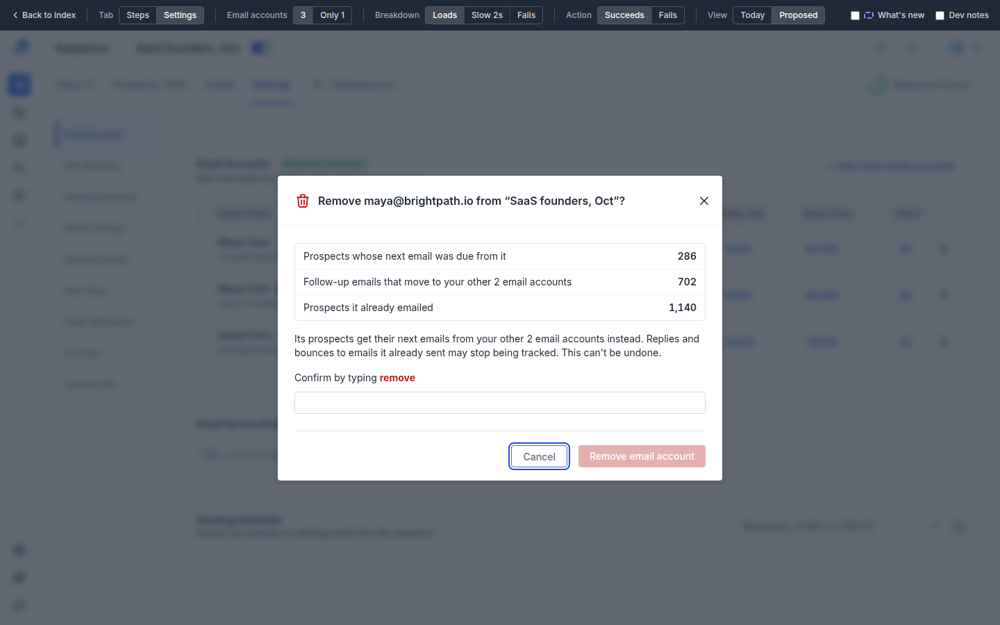

**Why it changes.** Deleting a step and removing a sender both move or stop live prospects, and neither dialog says so.

| ID | Case | Expected | P |
|---|---|---|---|
| ST-1 | Delete step 2 with 412 prospects on it | F names the step; consequence says they move to step 3 after its delay; no typed word | P0 |
| ST-2 | Remove the only email account | Consequence says the sequence pauses | P0 |

### 6.4 Unified Inbox (rows 8-10)

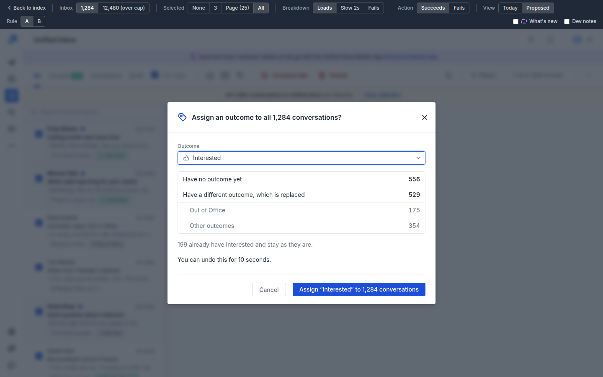

**Why it changes.** Bulk actions reach 10,000 threads, and the copy is written for one.

| ID | Case | Expected | P |
|---|---|---|---|
| IN-1 | Delete 25 | Title "Delete 25 conversations from Unified Inbox?"; says the emails stay in the mailbox; undo 10 s | P0 |
| IN-2 | Unsubscribe 25 | Title "Unsubscribe 25 prospects from every sequence?"; counts unique prospects, not threads | P0 |
| IN-3 | Assign "Interested" to 25 | Primary disabled until an outcome is picked; rows say how many outcomes are replaced; undo restores each thread's earlier outcome | P1 |

### 6.5 Tasks (row 11)

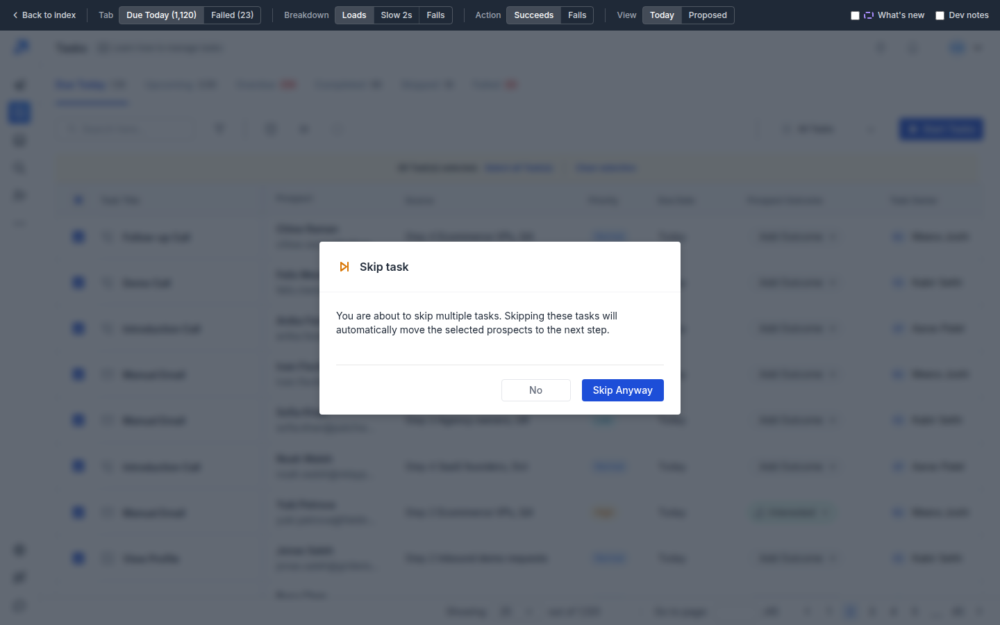

**Why it changes.** Bulk skip reaches 25,000 tasks and moves every prospect on, with a fixed singular title and no undo.

| ID | Case | Expected | P |
|---|---|---|---|
| TK-1 | Skip 36 | Title "Skip 36 tasks due today?"; rows by task type and prospects who move on; blue; undo 10 s | P0 |
| TK-2 | Skip 1 from the bar | F names the task and the prospect; primary "Skip task" | P1 |
| TK-3 | Hover Skip on one row | No dialog; undo toast lasts 10 s (today 5 s) | P1 |

### 6.6 CRM prospects and AI columns (rows 12-14, 16)

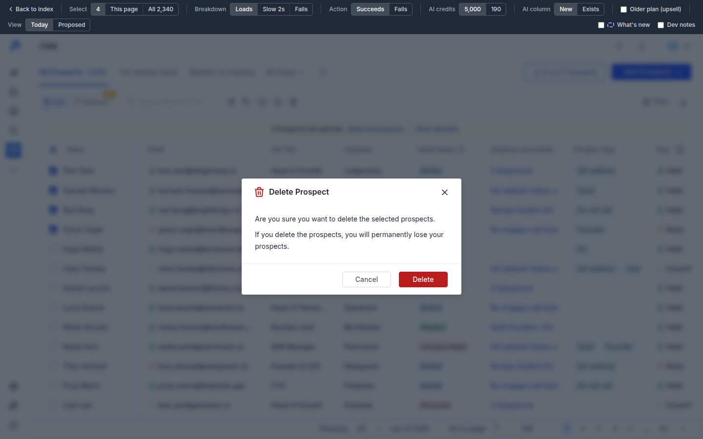

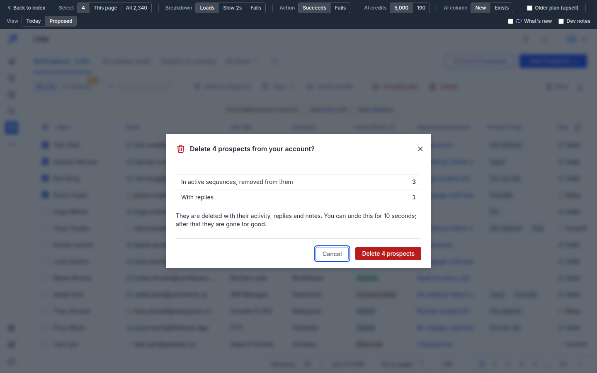

**Why it changes.** Delete is permanent and reaches 25,000 prospects; the AI column spends credits with no total.

| ID | Case | Expected | P |
|---|---|---|---|
| CR-1 | Delete 4 | Title "Delete 4 prospects from your account?"; rows: in active sequences, with replies, with notes; undo 10 s | P0 |
| CR-2 | Remove 2 tags, only 2 of 4 selected have them | Title and button count 2, not 4 | P1 |
| CR-3 | AI run with 190 credits for 480 rows | Shortfall shown; primary "Buy credits"; partial "Run on 190 rows" | P1 |

### 6.7 Import CSV (row 15)

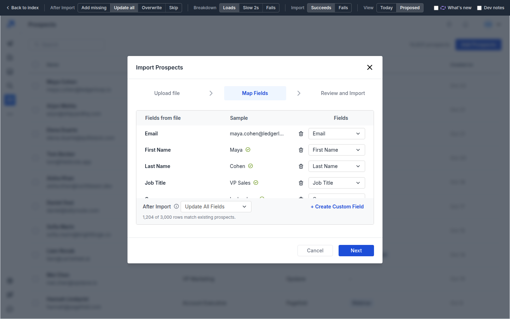

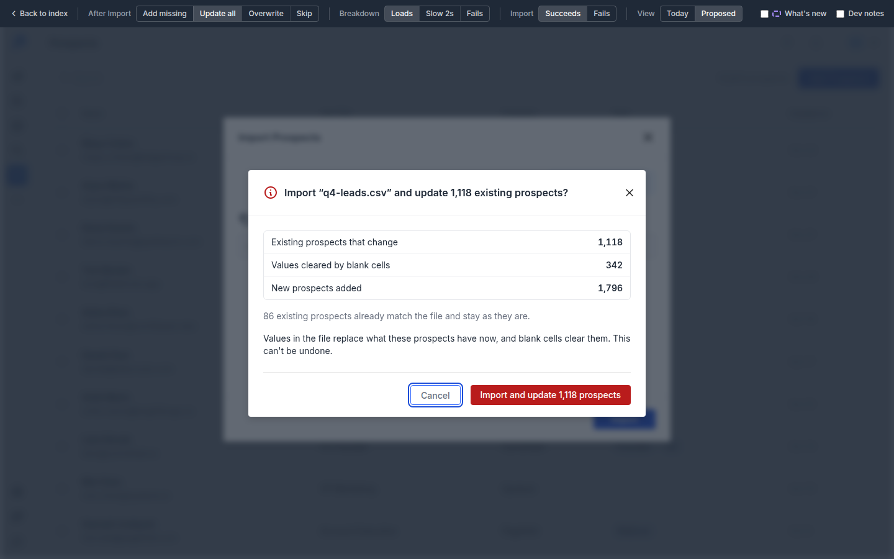

**Why it changes.** Both options overwrite existing prospects, and a blank cell erases a value; for Overwrite the option text never says so (measured in edge `4617c54`).

| ID | Case | Expected | P |
|---|---|---|---|
| CS-1 | Import with Update All Fields | Red F before import: existing prospects that change, values cleared by blank cells, new prospects added | P0 |
| CS-2 | Import with Add Missing Fields or Skip | No dialog; imports as today | P0 |

### 6.8 Email accounts (rows 17-20)

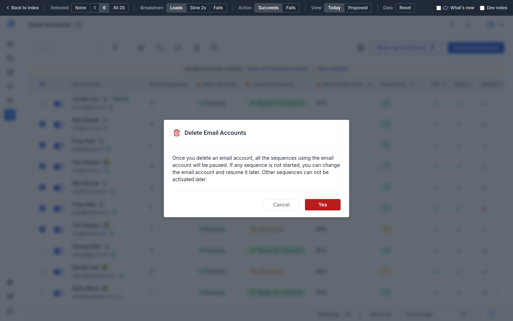

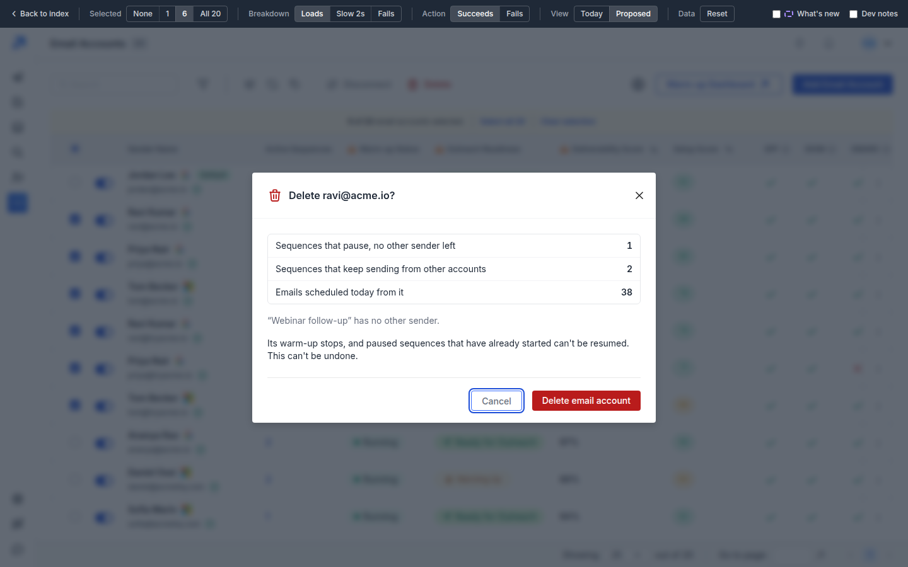

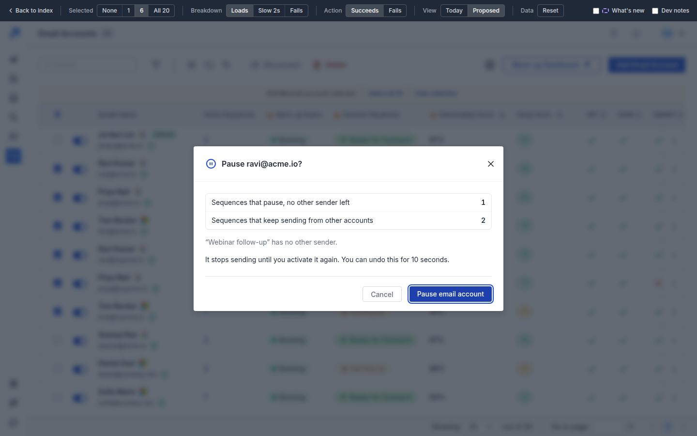

**Why it changes.** Deleting or pausing a mailbox stops every sequence that sends from it; the pause switch has no confirmation at all.

| ID | Case | Expected | P |
|---|---|---|---|
| EA-1 | Delete 6 | Names first 3 "and 3 more"; rows: active sequences that pause, emails scheduled today; no undo | P0 |
| EA-2 | Pause switch on one account | Blue F naming the account; undo 10 s | P1 |

### 6.9 Lead Finder and Email Verifier (rows 21-25)

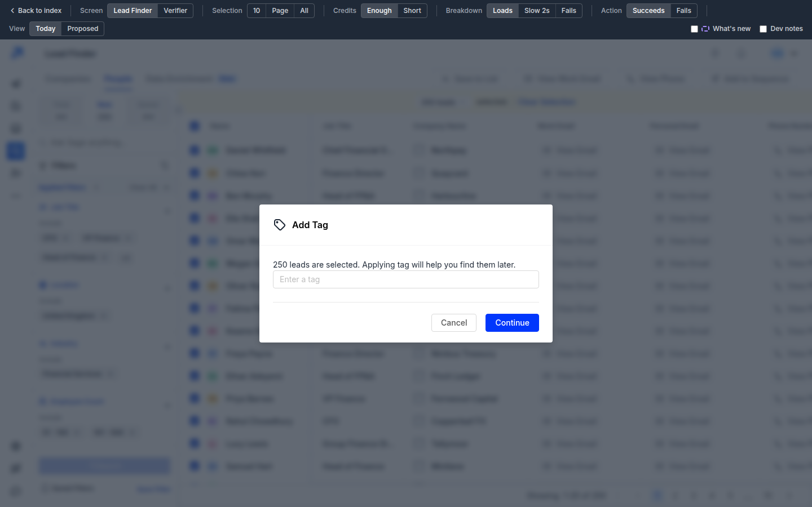

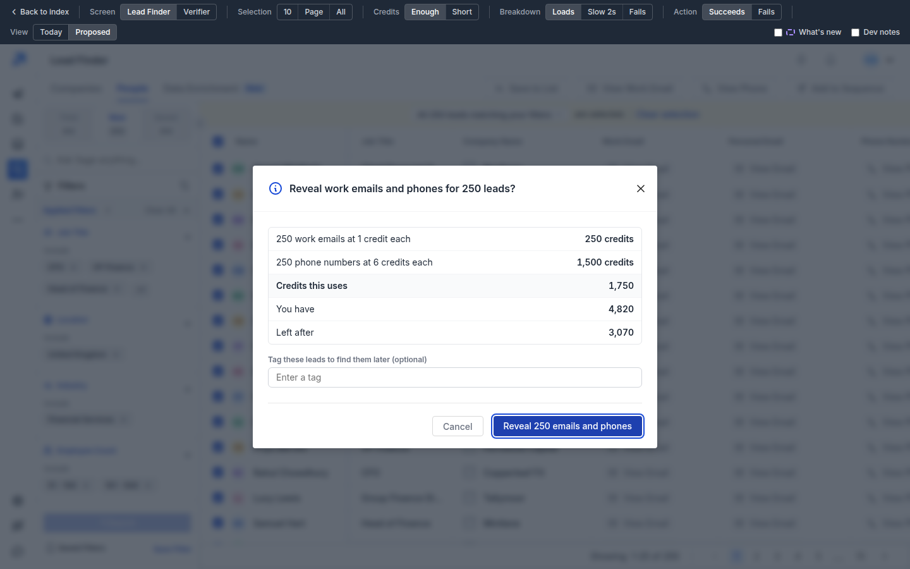

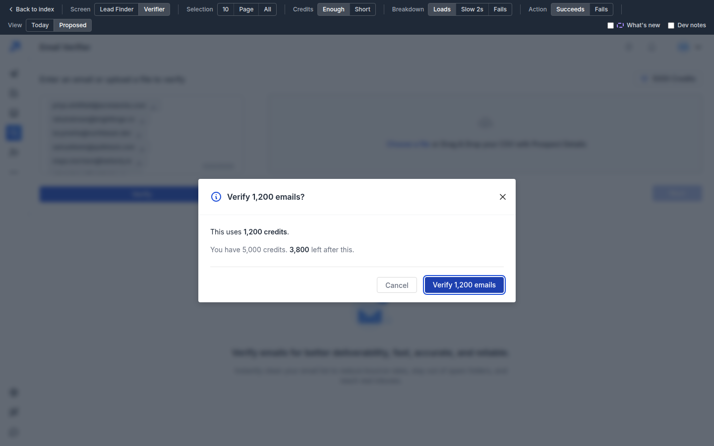

**Why it changes.** Spends happen without the total; the Email Verifier spends and clears the input on click.

| ID | Case | Expected | P |
|---|---|---|---|
| LF-1 | Reveal emails and phones for 250 | One row per type with its rate; total, balance, left after | P0 |
| LF-2 | Verify fails | Input is kept; it clears only on success | P1 |

### 6.10 Settings (rows 26-32)

**Why it changes.** Each of these names neither the item nor what depends on it; CRM disconnect and agency client password reset fire on one click.

| ID | Case | Expected | P |
|---|---|---|---|
| SE-1 | Delete user | Names the user; rows: sequences, prospects, email accounts they own; says where they go | P0 |
| SE-2 | Delete schedule used by sequences | Blocked inside the dialog with the reason and the sequences named, instead of the error after confirming | P1 |
| SE-3 | Disconnect HubSpot | Blue F naming the workflows that stop; says field mappings are kept | P1 |

### 6.11 Admin settings, profile and billing (rows 33-36)

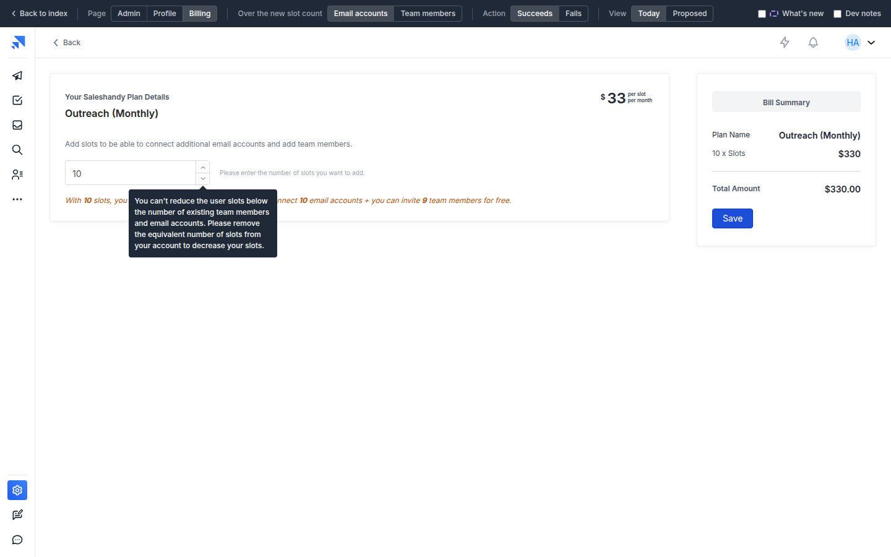

**Why it changes.** Security switches flip on one click; slot reduction is a dead end; Google users delete their account with no warning about what is erased.

| ID | Case | Expected | P |
|---|---|---|---|
| AB-1 | Switch off email codes | Primary disabled until the password is typed (or Google confirms); toast names the user count | P0 |
| AB-2 | Reduce 12 slots to 7 with 10 in use | Must pick exactly 3 mailboxes; bill before and after shown; change dated at renewal | P0 |
| AB-3 | Delete account, Google user | Lists what is erased; Delete stays disabled until Google confirms | P0 |

## 7. Reconciliation with existing behaviour

| Existing behaviour | What happens to it |
|---|---|
| Single "Remove from sequence" alert in the prospect drawer (AL-2724, Nov 2025) | Replaced by the F dialog, so single and bulk ask the same way |
| CRM "Delete Prospect" modal and the "Wait! No need to delete" upsell (10+ selected, older plans) | Replaced by F; the upsell survives as one muted line inside the dialog, under the consequence |
| Typed "delete" on Delete step | Replaced by F (D2) |
| Typed "delete" on Delete sequence | Replaced by F (D2) |
| Tasks single Skip / Complete undo toast (5 seconds) | Kept, raised to 10 seconds to match H |
| Bulk "Action Stats" modal after sequence pause / resume | Dropped; failures become a toast with a count and a reason |
| Slot input that refuses to go below what is in use | Replaced by the M picker (choose what goes) |
| SSO enable modal, password delete-account flow, API key and MCP disconnect dialogs | Unchanged; they already meet the bar and are the benchmarks |

## 8. Cross-cutting

**Every F dialog (release blocker if any is missing):**

| State | Behaviour |
|---|---|
| Counting | Opens at once with title and count; breakdown rows show placeholders at the same height as loaded rows; primary enabled |
| Breakdown fails | Breakdown replaced by "We couldn't load the details. You can still continue." Action still allowed |
| Submitting | Spinner on the primary; further clicks ignored |
| Action fails | Dialog stays open with what happened, why, and what to do |
| Keyboard | Esc and clicking outside cancel. Focus starts on Cancel for red dialogs, on the primary for blue |

**Every undo toast:** rows leave at once; 10-second ring; pauses on hover; Undo restores position and status; a second action commits the first at once; leaving the page still commits after 10 seconds.

## 9. Implementation notes

| Backend ask | Needed by | Resolve before estimation |
|---|---|---|
| Breakdown counts before the dialog opens (by status, knock-on counts) | F on bulk surfaces | Which counts can be served under 500 ms for 25,000 selected (assumed budget; confirm with dev) |
| Delay bulk changes 10 seconds and allow cancel | H | Which bulk jobs already run as background jobs (sequence prospects do: "Estimated time: 30 minutes"); CRM delete and email account delete unknown |
| Identity re-check for admin switches | K | Reuse the password delete-account check; how SSO owners re-check |
| Preview what a plan change cuts | M | What happens to a removed member's sequences and mailboxes at renewal |

Assumptions flagged on each screen's Dev notes in the prototype (for example: where a deleted user's data goes, whether a scheduled reply still sends after its thread is deleted) are **resolve before estimation**.

Not adopted: tiered friction rule, type-to-confirm, confirm in place, 30-day restore, activity log, second-admin approval.

## 10. Measurement

**Privacy:** never log prospect emails, names or message content in these events; counts and surface IDs only.

| Event | Fires when | Properties |
|---|---|---|
| `risky_action_dialog_shown` | F, K, L or M dialog opens | surface, action, count, breakdown_loaded |
| `risky_action_confirmed` | Primary clicked and succeeded | surface, action, count, ms_open |
| `risky_action_cancelled` | Cancel, Esc or outside click | surface, action, count |
| `risky_action_undone` | Undo clicked | surface, action, count, seconds_after |

| Indicator | Definition | Healthy | Investigate |
|---|---|---|---|
| **Cancel rate (most important early signal)** | cancelled / shown, per surface, day 1 to 14 | 2% to 15% (target) | Under 1% (dialog ignored) or over 30% (dialog blocks real work) |
| Undo rate | undone / confirmed, per surface | Under 5% (target) | Over 10%: the dialog is not doing its job on that surface |
| Support tickets about accidental removal or deletion | Tagged tickets per month, 90 days after full rollout | Down from baseline (baseline not measured; capture before stage 1) | Flat |

**Guardrail:** if any surface's undo rate is over 10% for 7 days, halt rollout of further surfaces and review that surface's copy.

Instrumentation ships with the feature; the gates in §11 cannot be read without it.

## 11. Rollout

Staged by surface as a blast-radius control, not an A/B test.

| Stage | Who | Gate |
|---|---|---|
| 1 | Sequence > Prospects (A, B, C, F, H) for all users | Events live; cancel and undo rates readable |
| 2 | CRM prospects, Unified Inbox, Tasks, Sequence list, email accounts | Stage 1 cancel rate within the healthy band for 14 days |
| 3 | Steps, CSV import, Lead Finder, Email Verifier, Settings, Admin, Billing | Stage 2 healthy for 14 days |

No stage starts before the delayed, cancellable job (H) works for that stage's surfaces.

## 12. Open questions

| # | Question | Why it matters | Recommendation |
|---|---|---|---|
| Q1 | Does bulk Resume touch subsequences? | The Resume breakdown needs it | Dev to confirm; prototype shows no subsequence row |
| Q2 | Where does a deleted user's data go? | The Delete user consequence states it | Prototype says it moves to the owner; confirm before stage 3 |
| Q3 | Does a scheduled reply still send after its thread is deleted? | Delete conversation breakdown counts it | Confirm in edge; if yes, deleting must cancel it |
| Q4 | Add 30-day restore later? | D3 leaves late mistakes unrecoverable | Revisit after 90 days of undo and support data |

Q3 is blocking for Unified Inbox in stage 2.

## 13. Priority & timeline

Priority: high (a defect class that deletes customer data). Target and release gate: per §11. **Named owners still required:** product (Hitesh), tech lead (Rajat), design review (Hemanshu), QA owner for the undo family (unassigned).

## Appendix – reference index

- [Prototype](prototype/index.html): design of record; Sequence > Prospects is the flagship.
- [Spec](https://github.com/product-team-sh/prd-safe-actions/blob/main/safe-actions-spec.md): copy, breakdown rows and states for all 37 surfaces; production CSS is the token source.
- [Audit](https://github.com/product-team-sh/prd-safe-actions/blob/main/confirmation-audit.md): every risky action in production with code links.
- [Directions](prototype/01-directions.html): the 13 directions explored.
- Source card: Basecamp, "Prospects gets deleted with just one click." (7 Oct 2026).
